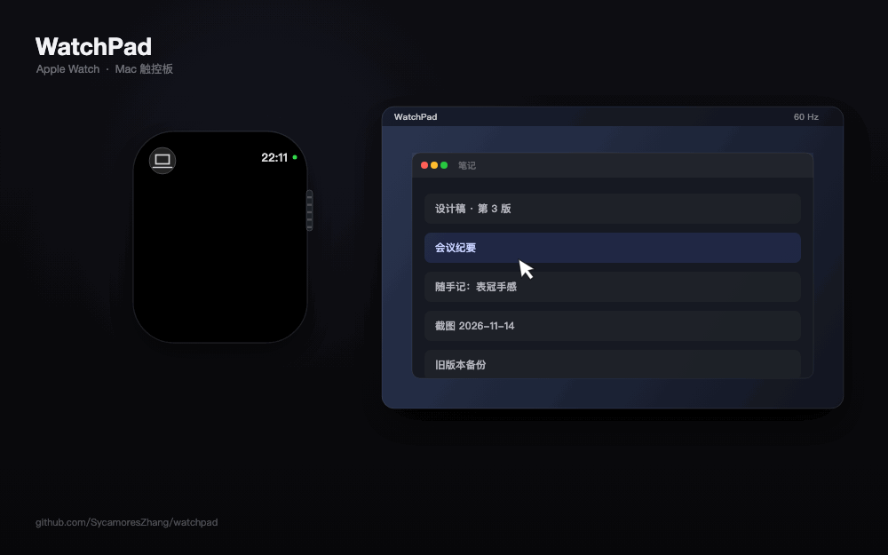

# WatchPad

[](https://github.com/SycamoresZhang)

把 Apple Watch 变成 Mac 的触控板：整屏纯黑触控区，表冠当滚轮，长按出右键。



> 基于 [umarz317/WatchPointer](https://github.com/umarz317/WatchPointer)（MIT）改造，手表端与 Mac 端都做了较大重写。

## 功能

**手表端**

- 纯黑圆角触控板，左上角系统 Liquid Glass 按钮进入菜单
- 触控：轻点左键、长按不动右键、长按后移动为拖拽
- 表冠：平滑/硬停两种手感，20 档等比灵敏度（中位档 0.12×），可反转方向
- 固定 60 Hz 光标包 + 0.5 s 心跳，抬手也不再显示"断开"
- 设置页可调：触控灵敏度、表冠灵敏度、长按时长、滚动模式、表冠反转

**Mac 端**

- 刘海/摄像头位置的状态面板：Apple Watch 名称、实时采样 Hz、电量
- 屏幕映射放大显示，展开时内容随面板边缘一起裁剪出现
- 平滑滚动实现（45 ms 静默收尾），硬停模式（丢弃余量）

## 编译

要求：Xcode 26（watchOS 26 SDK）。

```
cd WatchPad
xcodebuild -project WatchPointer.xcodeproj -scheme WatchPointer \
  -configuration Debug -destination 'generic/platform=watchOS' \
  -allowProvisioningUpdates build
```

**先改签名再编译**：`WatchPointer.xcodeproj` 里的 Team 与 Bundle Identifier 需要换成你自己的，否则装不上表（原作者的 Team 会导致注册失败）。

Mac 端为 SwiftPM 工程：

```
cd Mac
swift build -c release
```

产物在 `.build/arm64-apple-macosx/release/WatchPointer`，需要授予辅助功能权限。

## 安装到手表

```
xcrun devicectl device install app --device <手表 ID> <构建产物>/WatchPointer.app
```

手表必须亮屏（打开本 App 停在前台最佳），熄屏时安装必超时（`RemotePairingError 1034`）。

## 作者

**SycamoresZhang** — <https://github.com/SycamoresZhang>

问题、建议、想加的功能，直接到仓库开 Issue 或者在 GitHub 上找我。

## 授权

MIT，见 `LICENSE`。原项目版权归 Umar Afzal；手表端改造与 Mac 端面板由 [@SycamoresZhang](https://github.com/SycamoresZhang) 完成。
